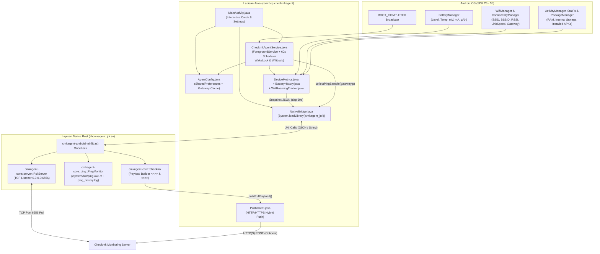

# about.md — Arsitektur & Bahasa Pemrograman Khusus Aplikasi Android (`BMS Agent`)

Dokumen ini menjelaskan secara khusus **arsitektur sistem**, **kombinasi bahasa pemrograman (Java + Rust JNI)**, **struktur modul**, serta **alur kerja internal** dari aplikasi Android **BMS Agent** (`cmkagent-android-release.apk`).

---

## 1. Identitas & Spesifikasi Aplikasi Android

| Parameter | Nilai / Spesifikasi |
| :--- | :--- |
| **Nama Aplikasi** | `BMS Agent` |
| **Application ID (Package)** | `com.bcp.checkmkagent` (Debug: `com.bcp.checkmkagent.debug`) |
| **Versi Agen (Checkmk)** | `Agen BMS : 1.0.2` (`versionName = "1.0.2"`, `versionCode = 23`) |
| **Minimum / Target Android SDK** | `minSdk 26` (Android 8.0 Oreo) s/d `compileSdk 35` (Android 15) |
| **Arsitektur CPU (ABI)** | `arm64-v8a` (64-bit ARM), `armeabi-v7a` (32-bit ARM), `x86_64` (Emulator/x86 Tablet) |
| **Port Monitoring Default** | TCP `6556` (Pull Primary) + HTTP/HTTPS POST (Push Backup Hybrid) |
| **Perangkat Sasaran** | Handheld PDA Scanner Gudang (mis. Newland MT93), Smartphone, & Tablet Operasional Cabang |

---

## 2. Bahasa Pemrograman yang Digunakan (Arsitektur Hybrid 2 Bahasa)

Aplikasi Android **BMS Agent** dibangun menggunakan arsitektur **Dual-Language Hybrid** yang memadukan **Java** di lapisan sistem Android dan **Rust** di lapisan *core engine* melalui **JNI (*Java Native Interface*)**:

### A. Java (Java 17 — Android Framework & UI Layer)
Terletak pada direktori `android/app/src/main/java/com/bcp/checkmkagent/`.
**Alasan teknis penggunaan Java:**
1. **Akses Native ke Layanan OS Android (ART):** Seluruh sensor perangkat Android (kesehatan & arus baterai `BatteryManager`, sinyal & BSSID Wi-Fi `WifiManager`, routing gateway `ConnectivityManager`, memori `ActivityManager`, penyimpanan `StatFs`, dan daftar APK `PackageManager`) hanya dapat diakses secara resmi dan stabil melalui API Android SDK berbasis Java/Kotlin.
2. **Manajemen Siklus Hidup Latar Belakang (*Foreground Service*):** Android menerapkan pembatasan daya ketat (*Doze Mode* & *Background Execution Limits*). Lapisan Java mengelola `CheckmkAgentService` dengan tipe `FOREGROUND_SERVICE_TYPE_DATA_SYNC`, `PARTIAL_WAKE_LOCK`, `WIFI_MODE_FULL_HIGH_PERF`, serta `BootReceiver` (`BOOT_COMPLETED`) agar agen tetap hidup 24/7 tanpa dimatikan OS.
3. **Antarmuka Pengguna (*Zero-Bloat Programmatic UI*):** `MainActivity.java` membangun seluruh tampilan kartu interaktif (*Expand/Collapse*, *Start/Stop Service*, *View Ping Log*, *Settings*) secara langsung menggunakan komponen native Android tanpa pustaka UI pihak ketiga, sehingga ukuran APK tetap sangat kecil (~1,8 MB) dan ringan di PDA gudang.

### B. Rust (Rust 2021 Edition — Native Core & Network Engine via JNI)
Terletak pada crate `crates/cmkagent-android-jni/` dan berbagi mesin inti `crates/cmkagent-core/` yang dikompilasi menggunakan **Android NDK (`cargo-ndk`)** menjadi pustaka biner native `libcmkagent_jni.so`.
**Alasan teknis penggunaan Rust:**
1. **Keseragaman Protokol 100% dengan Agen Linux & Windows:** Mesin pembuat output Checkmk (`<<<check_mk>>>`, `<<<local:sep(0)>>>`, `<<<local:cached(...):sep(0)>>>`), filter keamanan IP/CIDR/RFC1918, dan kalkulator statistik ping menggunakan kode Rust (`cmkagent-core`) yang **identik** dengan agen desktop.
2. **Server TCP Pull Multi-Thread & Non-Blocking (`PullServer`):** Menangani socket TCP `0.0.0.0:6556` secara langsung di kode native Rust dengan manajemen *socket timeout*, `TCP_NODELAY`, serta pembersihan thread otomatis tanpa membebani *Garbage Collector* (GC) Java.
3. **Eksekusi Ping Paralel 4x/Menit & Log Bergulir 30 Hari (`PingMonitor`):** Menggunakan `std::thread::scope` di Rust untuk menjalankan ICMP ping (`/system/bin/ping -c 4 -W 2`) ke 3 target (`8.8.8.8`, `192.168.122.10`, dan `Gateway Cabang`) secara paralel setiap 60 detik, menghitung metrik real-time `ping_loss_1m` (`0%–100%`) serta rata-rata 1 jam (`pl`, `rta`, `rtmin`, `rtmax`), dan merawat file `ping_history.log` (retensi 30 hari, batas ukuran 35 MB).
4. **Keamanan Memori & Konkurensi Tanpa *Data Race*:** State global disimpan dalam `OnceLock<RuntimeState>` yang dilindungi oleh `RwLock<AgentConfig>`, `Mutex<Arc<PingMonitor>>`, dan `AtomicU64` (`AgentStats`).

### C. Ringkasan Pembagian Peran Java vs Rust

| Lapisan / Fitur | Bahasa | Lokasi Kode | Tugas Utama |
| :--- | :--- | :--- | :--- |
| **UI Dashboard & Settings** | Java | `MainActivity.java`, `AgentConfig.java` | Kartu status interaktif, form konfigurasi, `SharedPreferences` |
| **Background Daemon & Locks** | Java | `CheckmkAgentService.java`, `BootReceiver.java` | Foreground Service 60s scheduler, WakeLock, WifiLock, Auto-Boot |
| **Hardware & OS Telemetry** | Java | `DeviceMetrics.java`, `BatteryHistory.java`, `WifiRoamingTracker.java` | Pembacaan baterai (µAh/mA/suhu/siklus), RAM, Storage, BSSID Roaming, & Inventory APK |
| **HTTP(S) Push Backup** | Java | `PushClient.java` | Pengiriman snapshot cadangan via `HttpURLConnection` ke Push Receiver |
| **Jembatan JNI** | Java + Rust | `NativeBridge.java` <-> `crates/cmkagent-android-jni/src/lib.rs` | Konversi tipe `JString`/`jboolean`/`jint` dan serialisasi JSON `serde_json` |
| **TCP Pull Server (6556)** | Rust | `crates/cmkagent-core/src/server.rs` | Listener TCP `0.0.0.0:6556`, validasi IP/CIDR/RFC1918, pengiriman payload |
| **Ping Engine & 30d Log** | Rust | `crates/cmkagent-core/src/ping.rs` | Ping paralel 3 target, grafik `ping_loss_1m` (0–100%), ringkasan putus 24 jam |
| **Checkmk Formatter & Stats** | Rust | `crates/cmkagent-core/src/checkmk.rs`, `stats.rs` | Penyusunan format section Checkmk & pencatatan statistik koneksi |

---

## 3. Diagram Arsitektur & Alur Data Aplikasi Android



---

## 4. Rincian Modul Kode Sumber Android

### A. Modul Java (`android/app/src/main/java/com/bcp/checkmkagent/`)
1. **`MainActivity.java`**
   - Menyediakan dashboard berlatar gelap (`#0D1518`) dengan 8 kartu yang dapat dibuka/tutup (*collapsible*): `AGENT`, `HYBRID TRANSPORT`, `BATTERY (1-LINE UNIFIED)`, `SYSTEM`, `NETWORK, AP ROAMING & PING (1H)`, `APPLICATIONS`, `DEVICE`, dan `SETTINGS`.
   - Memperbarui tampilan status secara otomatis setiap 3 detik saat layar aktif (`refreshTask`).
   - Menyediakan aksi instan: `▶ START AGENT`, `■ STOP AGENT`, `EXPAND ALL`, `COLLAPSE ALL`, `VIEW PING LOG` (menampilkan 150 baris terakhir `ping_history.log`), `PING 4X NOW`, dan `PUSH SNAPSHOT NOW`.
2. **`CheckmkAgentService.java`**
   - Berjalan sebagai Android `ForegroundService` (`NOTIF_ID = 6556`) dengan `PARTIAL_WAKE_LOCK` dan `WIFI_MODE_FULL_HIGH_PERF` agar radio Wi-Fi dan jadwal ping tetap aktif walaupun layar PDA terkunci.
   - Menjalankan `ScheduledExecutorService` setiap **60 detik** untuk:
     1. Memuat ulang konfigurasi ke Rust (`NativeBridge.updateConfig`).
     2. Mengumpulkan telemetri perangkat (`DeviceMetrics.buildSnapshotJson`) dan mengirimkannya ke Rust (`NativeBridge.updateSnapshot`).
     3. Memicu siklus ping 4x ke 3 target (`NativeBridge.collectPingSample`).
     4. Menjalankan HTTP(S) Push Backup jika fitur Push diaktifkan.
3. **`DeviceMetrics.java`**
   - Mengumpulkan data perangkat Android dan menyusunnya menjadi JSON (`AndroidSnapshotPayload`) berisi daftar `local_checks` (`Health_Battery`, `Android_Info`, `WiFi_Status`, `RAM_Usage`, `Storage_Usage`) serta `raw_sections` (`<<<lnx_uname>>>`, `<<<lnx_distro:sep(124)>>>`, `<<<lnx_cpuinfo:sep(58)>>>`, `<<<dmidecode:sep(58)>>>`, `<<<lnx_block_devices:sep(0)>>>`, `<<<lnx_packages:sep(124)>>>`).
   - Menerapkan **cache inventaris 6 jam** (`21.600.000 ms`) untuk pembacaan daftar paket APK (`PackageManager.getInstalledPackages`) agar tidak membebani CPU dan baterai pada setiap siklus 1 menit.
4. **`BatteryHistory.java`**
   - Mengatasi keterbatasan Android yang jarang melaporkan kapasitas penuh (`mAh`) secara langsung dengan mengombinasikan pembacaan Coulomb counter (`BATTERY_PROPERTY_CHARGE_COUNTER` dalam `µAh`), profil perangkat (`PowerProfile` / deteksi model PDA Newland `MT93` = `4800 mAh`), serta akumulasi persentase pengisian daya untuk menghitung **Real Health (%)** dan **Estimated Cycles** secara presisi.
5. **`WifiRoamingTracker.java`**
   - Memantau perpindahan BSSID Access Point dan kanal frekuensi (`2.4GHz`, `5GHz`, `6GHz`) setiap menit.
   - Mengidentifikasi vendor Access Point dari prefix MAC/OUI (`UniFi AP`, `MikroTik AP`, `Aruba AP`, `Cisco AP`) dan menghitung frekuensi roaming dalam 1 jam terakhir (`wifi_roam_1h`) beserta riwayat transisi terakhir (`BSSID lama -> BSSID baru [HH:mm:ss]`).
6. **`AgentConfig.java`**
   - Menyimpan konfigurasi agen di `SharedPreferences` (`cmkagent_rust_prefs`), mendeteksi IPv4 perangkat serta IP Gateway Wi-Fi dari `ConnectivityManager` / `DhcpInfo`.
   - Menyimpan cache `last_detected_gateway_ip` agar saat koneksi Wi-Fi terputus sementara, target `Ping_Gateway` tetap dipertahankan dan mencatat `100%` loss dengan akurat.
7. **`NativeBridge.java`**
   - Kelas pembungkus `static` yang memuat `System.loadLibrary("cmkagent_jni")` dan mendeklarasikan 11 method `native` penghubung Java ke Rust.
8. **`PushClient.java` & `BootReceiver.java`**
   - `PushClient.java`: mengirim output agen lengkap melalui HTTP(S) `POST` (dengan header `X-CMK-Hostname`, `Authorization: Bearer <token>`) dan melaporkan hasilnya kembali ke Rust (`NativeBridge.recordPushResult`).
   - `BootReceiver.java`: menangkap sinyal `BOOT_COMPLETED` dan `QUICKBOOT_POWERON` untuk menyalakan `CheckmkAgentService` secara otomatis saat perangkat dinyalakan.

### B. Modul Rust (`crates/cmkagent-android-jni/` & `crates/cmkagent-core/`)
1. **`crates/cmkagent-android-jni/src/lib.rs`**
   - Mengimplementasikan simbol-simbol JNI `Java_com_bcp_checkmkagent_NativeBridge_*`.
   - Mengelola singleton `RUNTIME: OnceLock<RuntimeState>` yang menyimpan `AgentConfig`, `AgentStats`, `PingMonitor`, snapshot metrik Android terakhir, serta instance `PullServer`.
   - Menggabungkan hasil `Agent_Status`, `Ping_*` (dari Rust `PingMonitor`), `Transport_Status`, serta local checks & raw sections dari Java menjadi satu payload teks Checkmk utuh.
2. **`crates/cmkagent-core/` (`config.rs`, `server.rs`, `ping.rs`, `checkmk.rs`, `stats.rs`, `cache.rs`)**
   - Crate murni Rust (tanpa dependensi spesifik OS desktop) yang menyediakan listener TCP `6556`, filter IP/CIDR/RFC1918, eksekutor ping paralel 4x/menit, metrik grafik real-time `ping_loss_1m` (`0%–100%`) di samping `pl` (1 jam) dan `rta`, serta generator payload Checkmk.

---

## 5. Kontrak Antarmuka JNI (`NativeBridge`)

| Method Java (`NativeBridge.java`) | Fungsi Rust (`crates/cmkagent-android-jni/src/lib.rs`) | Keterangan |
| :--- | :--- | :--- |
| `startPullServer(configJson, dataDir)` | `Java_..._startPullServer` | Menginisialisasi `PingMonitor` di `filesDir` aplikasi dan membuka listener TCP `0.0.0.0:6556` |
| `stopPullServer()` | `Java_..._stopPullServer` | Menghentikan thread `PullServer` dan melepas port `6556` |
| `updateConfig(configJson)` | `Java_..._updateConfig` | Memperbarui `AgentConfig` di memori Rust secara live tanpa memutus koneksi |
| `updateSnapshot(snapshotJson)` | `Java_..._updateSnapshot` | Menyimpan snapshot telemetri baterai, Wi-Fi, RAM, storage, & inventaris APK dari Java |
| `collectPingSample(gatewayIp)` | `Java_..._collectPingSample` | Menjalankan 4x ping paralel ke `8.8.8.8`, `192.168.122.10`, & gateway lalu menulis ke `ping_history.log` |
| `buildFullPayload()` | `Java_..._buildFullPayload` | Merakit output teks Checkmk lengkap untuk keperluan Pull maupun Push |
| `readPingLogTail(maxLines)` | `Java_..._readPingLogTail` | Membaca `N` baris terakhir dari log ping 30 hari untuk ditampilkan di dialog UI |
| `getStatsJson()` | `Java_..._getStatsJson` | Mengembalikan JSON statistik jumlah pull diterima/ditolak, IP client terakhir, & status push |
| `recordPushResult(ok, code, detail)` | `Java_..._recordPushResult` | Mencatat keberhasilan/kegagalan HTTP(S) Push dari `PushClient.java` ke `AgentStats` |
| `normalizeRemoteIp(ip)` | `Java_..._normalizeRemoteIp` | Menormalisasi alamat IPv6-mapped IPv4 (`::ffff:192.168.x.x` -> `192.168.x.x`) |
| `isClientAllowed(configJson, ip)` | `Java_..._isClientAllowed` | Mengecek apakah IP pengakses diizinkan oleh aturan whitelist / RFC1918 |

---

## 6. Daftar 14 Service Checkmk yang Dihasilkan APK Android

1. `Check_MK` — Status eksekusi pull & waktu respons agen.
2. `Check_MK Agent` — Informasi versi `Agen BMS : 1.0.2` & OS `android`.
3. `Check_MK Discovery` — Pemeriksaan service baru (0 *unmonitored clutter*).
4. `Check_MK HW/SW Inventory` — Inventaris CPU ARM/x86, RAM, kapasitas flash internal (`mmcblk0`), versi Android, & seluruh paket APK terinstal (cache 6 jam).
5. `Agent_Status` — Statistik pull diterima/ditolak, IP server Checkmk penarik terakhir, dan mode akses jaringan.
6. `Android_Info` — Pabrikan, model perangkat, versi Android, level SDK, dan *uptime*.
7. `Health_Battery` — Ringkasan 1-baris lengkap: persentase baterai, status charging/discharging, *Real Health (%)*, jumlah siklus (*cycles*), kapasitas penuh aktual vs desain (`mAh`), suhu (`°C`), voltase (`V`), dan arus (`mA`).
8. `Ping_8.8.8.8` — Monitoring ping Internet 4x/menit: grafik **`Ping loss 1m`** (`ping_loss_1m` `0%–100%` real-time per menit), grafik **`Packet loss`** (`pl` rata-rata 1 jam), grafik **`Round trip average`** (`rta`, `rtmin`, `rtmax`), serta daftar jam putus 24 jam terakhir (*terbaru dulu*).
9. `Ping_192.168.122.10` — Monitoring ping Server Lokal 4x/menit (dengan grafik `ping_loss_1m` `0%–100%`, `pl` 1 jam, `rta`, & daftar jam putus 24 jam).
10. `Ping_Gateway` — Monitoring ping IP Gateway Wi-Fi Cabang 4x/menit (tetap merekam `100%` loss saat Wi-Fi drop berkat cache `last_detected_gateway_ip`).
11. `RAM_Usage` — Persentase & kapasitas RAM terpakai/bebas/total (cache 30 menit, `WARN` 85%, `CRIT` 95%).
12. `Storage_Usage` — Persentase & kapasitas penyimpanan internal terpakai/bebas/total (cache 24 jam, `WARN` 85%, `CRIT` 95%).
13. `Transport_Status` — Status jalur komunikasi Hybrid (`PULL` primary + `PUSH HTTP(S)` backup).
14. `WiFi_Status` — Status koneksi Wi-Fi, SSID, BSSID & vendor AP (`UniFi`/`MikroTik`/`Aruba`/`Cisco`), pita frekuensi & kanal (`2.4GHz`/`5GHz`/`6GHz`), frekuensi roaming 1 jam terakhir (`wifi_roam_1h`), kekuatan sinyal (`dBm`), kecepatan link (`Mbps`), dan IP lokal.

---

## 7. Cara Build APK Android dari Source Code

```bash
# 1. Kompilasi library native Rust JNI untuk ketiga arsitektur Android
cargo ndk -t arm64-v8a -t armeabi-v7a -t x86_64 -o android/app/src/main/jniLibs build --release -p cmkagent-android-jni

# 2. Build APK Release & Debug menggunakan Gradle
cd android
gradle --no-daemon assembleRelease assembleDebug
```

File hasil build akan tersedia di:
- Release APK: `android/app/build/outputs/apk/release/app-release.apk`
- Debug APK: `android/app/build/outputs/apk/debug/app-debug.apk`
